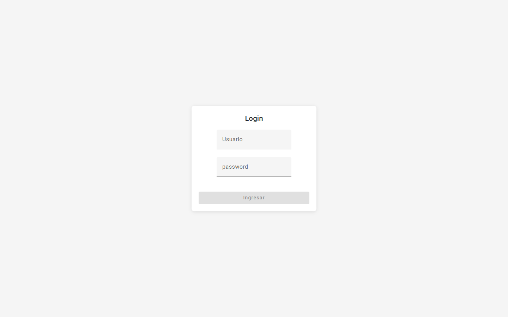

# Galería de fotografías: Angular, Node.js, PostgreSQL y Sequelize

Aplicación web full stack para publicar y administrar una galería de fotografías, con API REST en Node.js y frontend en Angular.


<p align="center"></p>

## Tabla de contenidos

- [Descripción](#descripción)
- [Estado del proyecto](#estado-del-proyecto)
- [Características](#características)
- [Tecnologías](#tecnologías)
- [Requisitos](#requisitos)
- [Instalación](#instalación)
- [Uso](#uso)
- [Estructura del proyecto](#estructura-del-proyecto)
- [Licencia](#licencia)
- [Autor](#autor)

## Descripción

Proyecto que combina Angular en el frontend con una API Express que persiste datos en PostgreSQL mediante el ORM Sequelize. La galería es pública, y un panel de administración protegido por login permite crear, editar y subir imágenes de fotografías.

## Estado del proyecto

**Ejercicio académico.** Proyecto de práctica que combina Angular, Express y Sequelize; no recibe desarrollo activo.

## Características

- Galería pública paginada (`/home/:num`).
- Login con JWT (`njwt`) y rutas de administración protegidas por guard (`/admin/list`, `/admin/new`, `/admin/edit/:id`).
- CRUD de fotografías con subida de imagen y generación de miniaturas (`node-thumbnail`).
- Modelos Sequelize `usuarios` y `fotografias`.
- Frontend con Angular Material, Bootstrap y soporte SSR.

## Tecnologías

- Frontend: Angular 18, Angular Material, Bootstrap 5, RxJS, TypeScript 5.4
- Backend: Node.js, Express 4, Sequelize 6, `pg`, `njwt`, `connect-multiparty`
- Base de datos: PostgreSQL

## Requisitos

- Node.js y npm
- PostgreSQL con una base de datos llamada `galeria-fotografias` (nombre configurado en `Backend/server/config/config.json`)

## Instalación

```bash
git clone https://github.com/ViceAguilera/Angular-NodeJS-PostgreSQL-Sequelize.git
cd Angular-NodeJS-PostgreSQL-Sequelize

cd Backend && npm install
cd ../Frontend && npm install
```

Configura las credenciales de PostgreSQL y el `token_secret` en `Backend/server/config/config.json` (sección `development`). El proyecto no incluye migraciones ni `sync()`, por lo que las tablas `usuarios` y `fotografias` deben existir según los modelos de `Backend/server/models/`.

> **Aviso:** el `config.json` versionado contiene valores de desarrollo de ejemplo. No los reutilices en ningún entorno real.

## Uso

Backend (puerto 8010 por defecto, o la variable `PORT`):

```bash
cd Backend
npm run dev     # con nodemon
npm start       # sin nodemon
```

Frontend (espera la API en `http://localhost:8010/api/`, definida en `Frontend/src/app/services/global.ts`):

```bash
cd Frontend
npm start
```

## Estructura del proyecto

```
Backend/
  bin/main.js          # Arranque del servidor HTTP
  app.js               # Express, CORS y registro de rutas
  server/
    auth/              # Middleware de autenticación JWT
    config/            # Configuración de base de datos
    controllers/       # Lógica de usuarios y fotografías
    models/            # Modelos Sequelize
    routes/            # Rutas /api/...
    uploads/           # Imágenes subidas y miniaturas
Frontend/
  src/app/components/  # Home, login, admin, listado y formularios
  src/app/services/    # Servicios HTTP, auth y guard
```

## Licencia

Distribuido bajo la licencia MIT. Ver [LICENSE](LICENSE).

## Autor

**Vicente Aguilera Arias** — [Portafolio](https://portfolio.iamsirius.cl) · [GitHub](https://github.com/ViceAguilera) · [LinkedIn](https://www.linkedin.com/in/vicenteaguilera/)
